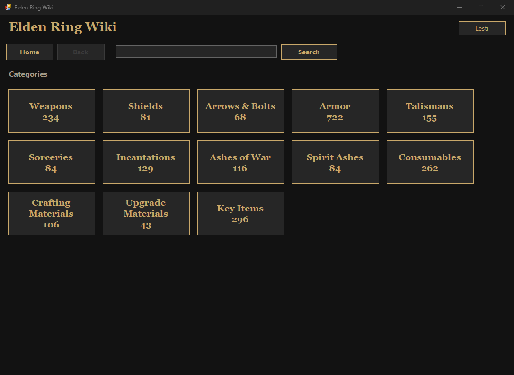

# Elden Ring Wiki (MKA_KursuseToo)

A Windows Forms desktop app for browsing Elden Ring weapons and talismans. Data is stored in a local SQLite database: the home page has a button for each item category and a search bar, and each item opens in a wiki-style details window.

Built as a course project (*kursusetöö*).

| Weapon list | Weapon details |
|---|---|
|  |  |

## Features

- **Home page**: one button per item category with the number of items in it, and a search bar. Weapons and
  Talismans work now; the other categories (Shields, Armor, Sorceries, Spirit Ashes, …) are greyed-out
  *Coming soon* buttons until their data is added.
- **Weapons**: buttons for *All Weapons* (234) and for each of the 30 weapon types. Click one to see its weapons.
- **Search** all categories at once. Results are grouped under a heading per category, e.g. *Weapons (10)* followed by
  *Talismans (1)*. Partial matches work, so "sword" finds every sword. Press **Enter** to search.
- **Home** and **Back** buttons to move between pages.
- **Detailed view**: click a weapon name to open its details in a wiki-style info table:
  - weapon type, damage (physical, magic, fire, lightning, holy), critical, guard boost, weight
  - upgrade path and max upgrade level
  - passive effect (e.g. `Hemorrhage (50)`) and where to find the weapon. Status buildup follows the affinity and
    upgrade level, e.g. a Blood Dagger shows `Hemorrhage (57)` at +0 and `Hemorrhage (82)` at +25
  - required Strength / Dexterity / Intelligence / Faith / Arcane
  - scaling for each stat as exact value and grade, e.g. `52 (D)`. Hover over it to see the grade's range (`D: 25–59`)
  - pick any **affinity** (Standard, Heavy, Keen, …) and **upgrade level** (+0 to +25, or +10 for somber weapons) to see how damage and scaling change
  - the window sizes itself to fit its content; long text such as locations wraps
- **Talismans**: every talisman in alphabetical order. Click one to see its effect, weight, sell value, the
  in-game description, and which talismans can't be worn together with it (e.g. a talisman and its +1 version).
  Talismans from Shadow of the Erdtree are marked as DLC. Locations aren't included yet.
  Until talismans are imported (see [Talismans](#talismans)), the list shows a note saying so.
- **Dark theme** with gold accents, inspired by the Fextralife wiki, and a dark title bar on Windows 10/11.
- **Resizable** main window: the list fills the window.
- **English / Estonian** switch in the top right corner; the choice is remembered (see [Languages](#languages)).

## Tech stack

| | |
|---|---|
| Language | C# |
| UI | Windows Forms |
| Framework | .NET Framework 4.7.2 |
| Database | SQLite (`elden_ring_weapons.db`) |
| Data access | `Microsoft.Data.Sqlite` (NuGet) |
| Translations | .NET resource files (`.resx`) |

## Getting started

### Requirements

- Windows
- Visual Studio 2022 or newer (or JetBrains Rider) with the **.NET desktop development** workload
- .NET Framework 4.7.2 Developer Pack

### Run

1. Clone the repository:
   ```
   git clone https://github.com/TeDDzTeR99/MKA_Kursusetoo.git
   ```
2. Open `MKA_KursuseToo.slnx` in Visual Studio.
3. Restore NuGet packages (Visual Studio usually does this automatically).
4. Press **F5** to build and run.

The database file is copied to the output folder (`bin\Debug`) on build, so no extra setup is needed.

## Project structure

```
MKA_KursuseToo/
├── Program.cs               # Entry point, starts the Main form
├── Main.cs                  # Main window: home page with category buttons, lists, grouped search
├── Main.Designer.cs         # Main window layout (generated by the designer)
├── DetailedView.cs          # Weapon details window
├── DetailedView.Designer.cs # Details window layout (generated by the designer)
├── TalismanView.cs          # Talisman details window (layout built in code)
├── WeaponDatabase.cs        # Shared database access (path + query helper)
├── Theme.cs                 # Dark theme with gold accents, used by both windows
├── Properties/
│   ├── Resources.resx       # All interface texts (English, default)
│   └── Resources.et.resx    # Estonian translations
├── elden_ring_weapons.db    # SQLite database
├── Database/                # Database migrations and the game-data import scripts
├── App.config
└── packages.config          # NuGet dependencies
docs/                        # Screenshots used in this README
```

## Languages

All interface texts (window titles, buttons, column headers, field names and messages) are stored in
`Properties/Resources.resx`, with Estonian translations in `Properties/Resources.et.resx`. Field names are
stored as `Field_<column name>`, e.g. `Field_weapon_type` = "Weapon Type" / "Relva tüüp".

The button in the top right corner of the main window switches between English and Estonian. It shows the name
of the other language ("Eesti" / "English"), and the whole window, including the page you're on, changes at once.
The choice is saved as a user setting (`Properties/Settings.settings`, stored in `%LOCALAPPDATA%\MKA_KursuseToo`),
so the app starts in the same language next time. Until a language has been picked, the app follows the Windows
**display language**: Estonian on Estonian Windows, English otherwise.

To add another language, copy `Resources.et.resx` to e.g. `Resources.fi.resx`, translate the values,
and add it to the project the same way. The switch only toggles between English and Estonian, so a third
language would need a dropdown instead. Game data (weapon names, locations, affinity names) stays in English,
as it comes from English sources.

## Database

| Table | Contents |
|---|---|
| `weapons` | Name, type, base damage, critical, guard boost, weight, upgrade info, special effect (staffs/seals), location |
| `weapon_types` | Weapon categories (Dagger, Greatsword, …) |
| `weapon_requirements` | Stat requirements per weapon |
| `weapon_scaling` | Scaling grade (`*_grade_id`) and exact value (`*_value`) per stat, one row per weapon, affinity and upgrade level |
| `weapon_damage` | Physical, magic, fire, lightning and holy damage, plus status buildup (bleed, frost, poison, scarlet rot, sleep, madness, death blight), one row per weapon, affinity and upgrade level |
| `affinities` | Standard, Heavy, Keen, Quality, Fire, Flame Art, Lightning, Sacred, Magic, Cold, Poison, Blood, Occult |
| `scaling_grades` | Grade letters S, A, B, C, D, E, - with the value range each one covers |
| `talismans` | Name, effect, description, weight, sell value, accessory group (talismans in one group can't be worn together), DLC flag. The ID is the talisman's row ID in the game data |
| `key_items` | Name, effect, description, sell value, kind (keys, maps, cookbooks, bell bearings, …), DLC flag, in the game's inventory order. The ID is the item's row ID in `EquipParamGoods` |

There is also a view, `v_weapons_overview`, that joins all of the above into one row per weapon (Standard affinity, +0).

### Scaling grades

| Grade | Scaling value |
|---|---|
| S | 175+ |
| A | 140–174 |
| B | 90–139 |
| C | 60–89 |
| D | 25–59 |
| E | 1–24 |

### Where the data comes from

Damage, status buildup, scaling, requirements, weapon types and upgrade paths come from the game's own data (patch 1.17), as extracted by the open-source
[Elden Ring Weapon Calculator](https://github.com/ThomasJClark/elden-ring-weapon-calculator) by Tom Clark (MIT license).
In the game, damage and scaling at a given level = the weapon's base value × the upgrade multiplier for that level.
The values were spot-checked against the [Fextralife wiki](https://eldenring.wiki.fextralife.com).
To re-import them, download `public/regulation-vanilla-v1.17.js` from the calculator repository and run:

```
python MKA_KursuseToo/Database/import_from_game_data.py regulation-vanilla-v1.17.js MKA_KursuseToo/elden_ring_weapons.db
```

Weight, critical, guard boost and the special effects of staffs and seals come from the weapon type pages on the
[Fextralife wiki](https://eldenring.wiki.fextralife.com) (e.g. [Daggers](https://eldenring.wiki.fextralife.com/Daggers)),
see `004_weight_critical_guard_passive.sql`. Locations come from each weapon's own Fextralife page,
shortened to the main one or two sources, see `005_locations.sql`.

#### Talismans

Talismans come from the game's own data, exported from your own copy of Elden Ring (Fextralife's terms don't allow
collecting their pages with a script, so it isn't used for talismans):

1. **Numbers**: export the `EquipParamAccessory` param as CSV, e.g. with [Smithbox](https://github.com/vawser/Smithbox)
   (Param Editor). The script uses the `ID`, `weight`, `sellValue` and `accessoryGroup` columns.
2. **Text**: unpack `msg/engus/item.msgbnd.dcx` (e.g. with [WitchyBND](https://github.com/ividyon/WitchyBND)) and convert
   the `.fmg` files to XML. The script reads `AccessoryName`, `AccessoryInfo` (effect) and `AccessoryCaption`
   (description), including the `_dlc01` / `_dlc02` versions for Shadow of the Erdtree.
3. Run `008_talismans.sql` once (already applied to the included database), then:

```
python MKA_KursuseToo/Database/import_talismans.py EquipParamAccessory.csv <folder with the .fmg.xml files> MKA_KursuseToo/elden_ring_weapons.db
```

The script replaces all talismans each time, so it can be run again after a game patch. The effect text is the game's
own short description (e.g. "Raises maximum HP"); exact percentages aren't in the text files.

#### Key items

Key items come from `EquipParamGoods` (the same CSV export as above) and the `GoodsName`, `GoodsInfo` and
`GoodsCaption` text files. They are grouped by the game's own inventory order (`sortId`) into kinds like Keys,
Maps, Cookbooks and Bell Bearings. `ShopLineupParam` gives what the stone, glovewort and peddler bell bearings
add to the Twin Maiden Husks' shop, and `ShopLineupParam_Recipe` the recipes each cookbook teaches (table `key_item_unlocks`). Run `013_key_items.sql` once (already applied to the included database), then:

```
python MKA_KursuseToo/Database/import_key_items.py EquipParamGoods.csv <folder with the .fmg.xml files> ShopLineupParam.csv ShopLineupParam_Recipe.csv MKA_KursuseToo/elden_ring_weapons.db
```

Item pictures for every category come from the game files too, see `import_icons.py` (needs WitchyBND and Pillow).

### Migrations

Changes to the database structure are kept as SQL scripts in `MKA_KursuseToo/Database/`:

| Script | What it does |
|---|---|
| `001_scaling_levels_affinities.sql` | Adds affinities, upgrade levels and grade ranges to the scaling data |
| `002_remove_non_weapons.sql` | Removes 12 entries that weren't real weapons or were duplicates |
| `003_damage_per_level_affinity.sql` | Adds the `weapon_damage` table for damage per affinity and upgrade level |
| `004_weight_critical_guard_passive.sql` | Sets weight, critical, guard boost and passive effect from Fextralife |
| `005_locations.sql` | Sets where to find each weapon, from Fextralife |
| `006_remove_damage_types.sql` | Removes the unused `damage_types` tables (replaced by `affinities`) |
| `007_status_buildup_per_level_affinity.sql` | Adds status buildup per affinity and level; `passive_effect` becomes `special_effect` |
| `008_talismans.sql` | Adds the `talismans` table (filled by `import_talismans.py`) |
| `013_key_items.sql` | Adds the `key_items` table (filled by `import_key_items.py`) |

## Author

TeDDzTeR99
