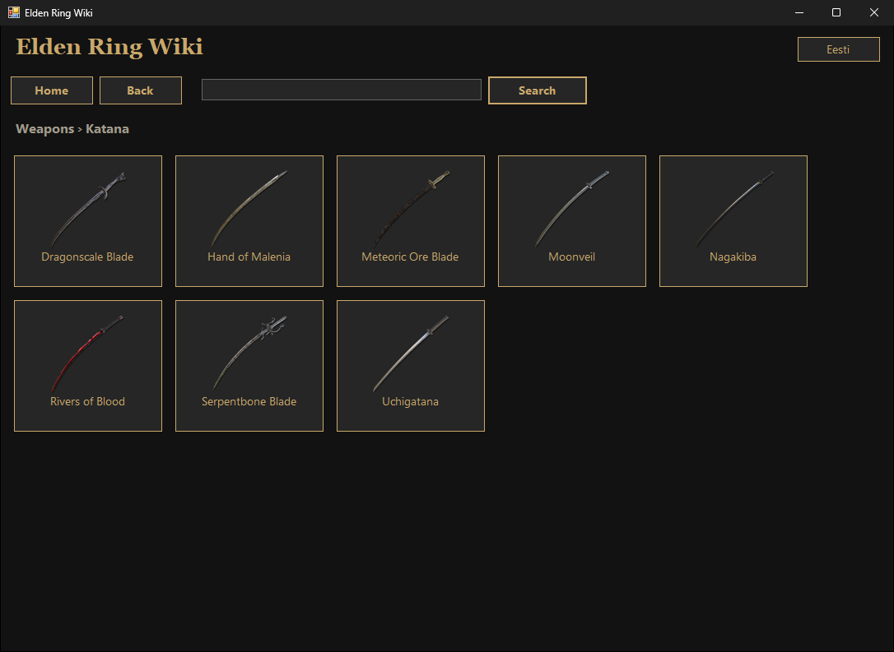
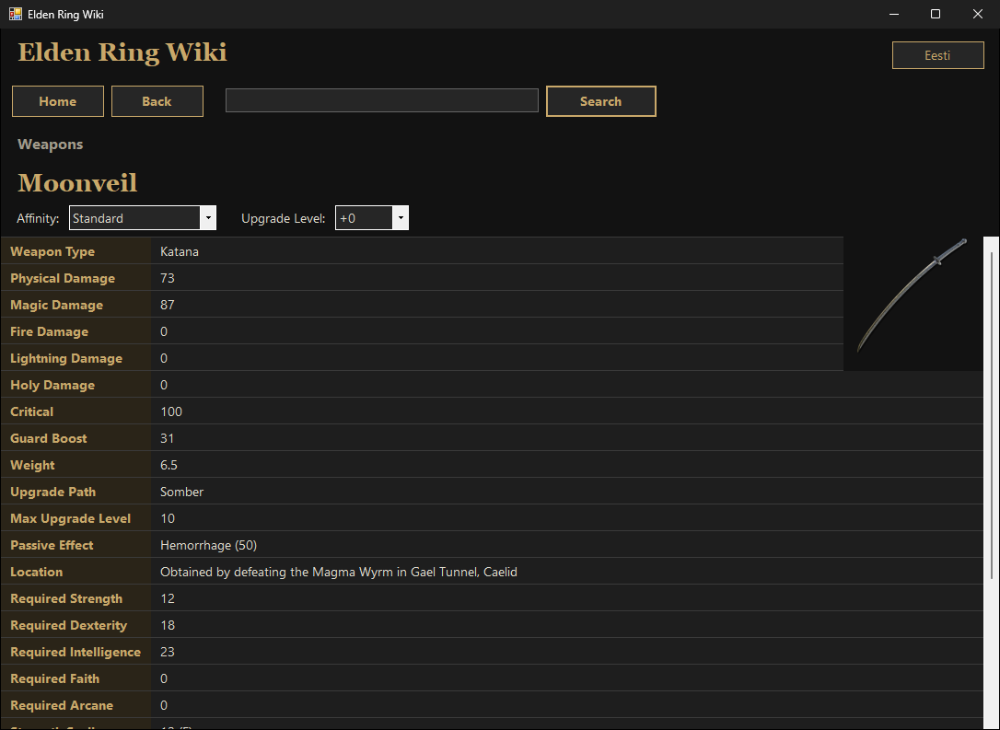

# Elden Ring Wiki (MKA_KursuseToo)

A Windows Forms desktop app for browsing Elden Ring items: weapons, shields, arrows and bolts, armor, talismans,
sorceries, incantations, ashes of war, spirit ashes, consumables, crafting materials, upgrade materials and key items,
including Shadow of the Erdtree. Data is stored in a local SQLite database: the home page has a button for each item
category and a search bar, and each item opens in a wiki-style details page with its in-game picture.

Built as a course project (*kursusetöö*).

| Home page | Item list | Weapon details |
|---|---|---|
|  |  |  |

## Features

- **Home page**: one button per item category with the number of items in it, and a search bar.
- **13 categories**, each split into the kinds the game itself uses. Every category opens on a page of buttons:
  one for *All …* and one per kind, each with its item count. Click one to see its items.

  | Category | Items | Kinds |
  |---|---|---|
  | Weapons | 234 | the 30 weapon types (Dagger, Straight Sword, …) |
  | Shields | 81 | small, medium, greatshields, thrusting shields |
  | Arrows & Bolts | 68 | arrows, greatarrows, bolts, greatbolts |
  | Armor | 722 | head, chest, arms, legs |
  | Talismans | 155 | (one alphabetical list) |
  | Sorceries | 84 | by school (Glintstone, Carian, …) |
  | Incantations | 129 | by school (Golden Order, Dragon Cult, …) |
  | Ashes of War | 116 | by default affinity, plus bow and shield ashes |
  | Spirit Ashes | 84 | Grave Glovewort or Ghost Glovewort upgrades |
  | Consumables | 262 | flasks, food, pots, aromatics, throwing items, greases, tools, runes, multiplayer items, … |
  | Crafting Materials | 106 | animal parts, plants, minerals & objects |
  | Upgrade Materials | 43 | smithing stones, somber smithing stones, gloveworts, … |
  | Key Items | 296 | keys, maps, cookbooks, bell bearings, quest items, … |
- **Item pictures**: every item shows its in-game icon, in the lists and on its details page.
- **Search** all categories at once. Results are grouped under a heading per category, e.g. *Weapons (10)* followed by
  *Talismans (1)*. Partial matches work, so "sword" finds every sword. Press **Enter** to search.
- **Home** and **Back** buttons to move between pages.
- **Detailed view**: click a weapon name to open its details in a wiki-style info table:
  - weapon type, damage (physical, magic, fire, lightning, holy), critical, guard boost, weight
  - upgrade path and max upgrade level
  - passive effect (e.g. `Hemorrhage (50)`) and where to find the weapon. Status buildup follows the affinity and
    upgrade level, e.g. a Blood Dagger shows `Hemorrhage (57)` at +0 and `Hemorrhage (82)` at +25
  - required Strength / Dexterity / Intelligence / Faith / Arcane
  - scaling for each stat as exact value and grade, e.g. `52 (D)`. Hover over it to see the grade's range (`D: 25–59`)
  - pick any **affinity** (Standard, Heavy, Keen, …) and **upgrade level** (+0 to +25, or +10 for somber weapons) to see how damage and scaling change
  - the window sizes itself to fit its content; long text such as locations wraps
- **Details pages for the other categories** show what the in-game menu shows, plus the in-game description.
  Items from Shadow of the Erdtree are marked as DLC. For example:
  - talismans: effect, weight, sell value, and which talismans can't be worn together with it
  - armor: weight, poise, damage negation and resistances; shields: guard negation, guard boost, damage, requirements and scaling
  - spells: FP, stamina, memory slots and requirements; ashes of war: FP cost, affinities and the weapon types they fit
  - upgrade materials: how many each upgrade level needs; bell bearings and cookbooks: what they unlock
  - consumables and materials: effect, FP cost, how many can be carried and stored, sell value
  - crafting materials: which items they're used to craft, and how many each needs
- **Dark theme** with gold accents, inspired by the Fextralife wiki, and a dark title bar on Windows 10/11.
- **Resizable** main window: the list fills the window.
- **English / Estonian** switch in the top right corner; the choice is remembered (see [Languages](#languages)).

## Tech stack

| | |
|---|---|
| Language | C# |
| UI | Windows Forms |
| Framework | .NET Framework 4.7.2 |
| Database | SQLite (`elden_ring_weapons.db`) |
| Data access | `Microsoft.Data.Sqlite` (NuGet) |
| Translations | .NET resource files (`.resx`) |

## Install

Download `EldenRingWikiSetup.exe` from the [latest release](https://github.com/TeDDzTeR99/MKA_Kursusetoo/releases/latest)
and run it. It installs the app with its database and every item picture (about 170 MB), adds it
to the Start menu (and, if you tick the box, the desktop), and can be removed again under **Settings → Apps**.
You can install it for yourself only (no admin rights needed) or for all users. Needs Windows 10 or 11.

### Building the installer

The installer is made with [Inno Setup 6](https://jrsoftware.org/isinfo.php) (`winget install JRSoftware.InnoSetup`)
from `installer/EldenRingWiki.iss`. From the repository root:

```
MSBuild MKA_KursuseToo\MKA_KursuseToo.csproj -p:Configuration=Release
ISCC installer\EldenRingWiki.iss
```

The setup file is written to `installer\Output\EldenRingWikiSetup.exe` (not committed: it is ~155 MB). It packs
whatever is in `bin\Release`, so re-run the imports and the Release build first if the data has changed. When
releasing a new version, raise `AppVersion` in the `.iss` file.

## Getting started

### Requirements

- Windows
- Visual Studio 2022 or newer (or JetBrains Rider) with the **.NET desktop development** workload
- .NET Framework 4.7.2 Developer Pack

### Run

1. Clone the repository:
   ```
   git clone https://github.com/TeDDzTeR99/MKA_Kursusetoo.git
   ```
2. Open `MKA_KursuseToo.slnx` in Visual Studio.
3. Restore NuGet packages (Visual Studio usually does this automatically).
4. Press **F5** to build and run.

The database file is copied to the output folder (`bin\Debug`) on build, so no extra setup is needed.

## Project structure

```
MKA_KursuseToo/
├── Program.cs               # Entry point, starts the Main form
├── Main.cs                  # Main window: home page with category buttons, lists, grouped search
├── Main.Designer.cs         # Main window layout (generated by the designer)
├── DetailedView.cs          # Weapon details page (affinity and upgrade level pickers)
├── DetailedView.Designer.cs # Weapon details layout (generated by the designer)
├── InfoboxView.cs           # Base class for the other details pages: picture + field/value table
├── TalismanView.cs, ArmorView.cs, ShieldView.cs, AmmoView.cs, SpellView.cs, AshOfWarView.cs,
│   SpiritAshView.cs, ConsumableView.cs, CraftingMaterialView.cs, UpgradeMaterialView.cs,
│   KeyItemView.cs           # One details page per category, each built on InfoboxView
├── ItemImages.cs            # Loads Images/<kind>/<id>.png and draws it on the details pages
├── WeaponDatabase.cs        # Shared database access (path + query helper)
├── Theme.cs                 # Dark theme with gold accents
├── Properties/
│   ├── Resources.resx       # All interface texts (English, default)
│   └── Resources.et.resx    # Estonian translations
├── elden_ring_weapons.db    # SQLite database
├── Images/                  # Item pictures, one folder per category, named by the item's id
├── Database/                # Database migrations and the game-data import scripts
├── App.config
└── packages.config          # NuGet dependencies
docs/                        # Screenshots used in this README
installer/EldenRingWiki.iss  # Inno Setup script that builds EldenRingWikiSetup.exe
```

## Languages

All interface texts (window titles, buttons, column headers, field names and messages) are stored in
`Properties/Resources.resx`, with Estonian translations in `Properties/Resources.et.resx`. Field names are
stored as `Field_<column name>`, e.g. `Field_weapon_type` = "Weapon Type" / "Relva tüüp".

The button in the top right corner of the main window switches between English and Estonian. It shows the name
of the other language ("Eesti" / "English"), and the whole window, including the page you're on, changes at once.
The choice is saved as a user setting (`Properties/Settings.settings`, stored in `%LOCALAPPDATA%\MKA_KursuseToo`),
so the app starts in the same language next time. Until a language has been picked, the app follows the Windows
**display language**: Estonian on Estonian Windows, English otherwise.

To add another language, copy `Resources.et.resx` to e.g. `Resources.fi.resx`, translate the values,
and add it to the project the same way. The switch only toggles between English and Estonian, so a third
language would need a dropdown instead. Game data (weapon names, locations, affinity names) stays in English,
as it comes from English sources.

## Database

| Table | Contents |
|---|---|
| `weapons` | Name, type, base damage, critical, guard boost, weight, upgrade info, special effect (staffs/seals), location, in-game description. The ID is the row ID in `EquipParamWeapon` |
| `weapon_types` | Weapon categories (Dagger, Greatsword, …) |
| `weapon_requirements` | Stat requirements per weapon |
| `weapon_scaling` | Scaling grade (`*_grade_id`) and exact value (`*_value`) per stat, one row per weapon, affinity and upgrade level |
| `weapon_damage` | Physical, magic, fire, lightning and holy damage, plus status buildup (bleed, frost, poison, scarlet rot, sleep, madness, death blight), one row per weapon, affinity and upgrade level |
| `affinities` | Standard, Heavy, Keen, Quality, Fire, Flame Art, Lightning, Sacred, Magic, Cold, Poison, Blood, Occult |
| `scaling_grades` | Grade letters S, A, B, C, D, E, - with the value range each one covers |
| `talismans` | Name, effect, description, weight, sell value, accessory group (talismans in one group can't be worn together), DLC flag. The ID is the talisman's row ID in the game data |
| `talisman_stats` | The numbers behind each talisman's effect (e.g. max HP +6%), from `SpEffectParam` |
| `upgrade_materials` | Name, effect, description, sell value, kind (smithing stones, gloveworts, …), DLC flag. The ID is the row ID in `EquipParamGoods` |
| `upgrade_material_costs` | How many of a material each upgrade level needs, for regular weapons, somber weapons and spirit ashes |
| `key_items` | Name, effect, description, sell value, kind (keys, maps, cookbooks, bell bearings, …), DLC flag, in the game's inventory order. The ID is the item's row ID in `EquipParamGoods` |
| `key_item_unlocks` | What each bell bearing adds to the Twin Maiden Husks' shop (with price) and which recipes each cookbook teaches |
| `spells` | Sorceries and incantations: name, school, effect, description, FP, stamina, memory slots, Intelligence / Faith / Arcane requirements, DLC flag. The views `sorceries` and `incantations` split it by type. The ID is the spell's row ID in `EquipParamGoods` and `Magic` |
| `ashes_of_war` | Name, kind (default affinity, or bow / shield), default affinity, every affinity it can give, weapon types it fits, skill FP cost, description, DLC flag. The ID is the row ID in `EquipParamGem` |
| `spirit_ashes` | Name, upgrade material (Grave / Ghost Glovewort), effect, description, summoning FP or HP cost, max upgrade level, DLC flag. The ID is the +0 row ID in `EquipParamGoods` |
| `armor` | Name, slot (head / chest / arms / legs), effect, description, weight, poise, damage negation (physical, strike, slash, pierce, magic, fire, lightning, holy), resistances (immunity, robustness, focus, vitality), sell value, DLC flag. The ID is the row ID in `EquipParamProtector` |
| `shields` | Name, kind (small / medium / great / thrusting), description, weight, guard negation and guard boost, damage, requirements, scaling letters (Standard +0), max upgrade level, DLC flag. The ID is the row ID in `EquipParamWeapon` |
| `ammunition` | Arrows and bolts: name, kind (arrow / great arrow / bolt / greatbolt), description, damage, max carried, sell value, DLC flag. The ID is the row ID in `EquipParamWeapon` |
| `consumables` | Name, kind (flasks, food, pots, aromatics, throwing items, special items, greases, tools, runes, multiplayer items), effect, description, FP cost, max carried, max stored, sell value, DLC flag. The ID is the row ID in `EquipParamGoods` |
| `crafting_materials` | Name, kind (animal parts / plants / minerals & objects), description, max carried, max stored, sell value, DLC flag. The ID is the row ID in `EquipParamGoods` |
| `crafting_material_uses` | Which items each crafting material is used to craft, and how many one craft needs |

There is also a view, `v_weapons_overview`, that joins all of the above into one row per weapon (Standard affinity, +0).

### Scaling grades

| Grade | Scaling value |
|---|---|
| S | 175+ |
| A | 140–174 |
| B | 90–139 |
| C | 60–89 |
| D | 25–59 |
| E | 1–24 |

### Where the data comes from

Damage, status buildup, scaling, requirements, weapon types and upgrade paths come from the game's own data (patch 1.17), as extracted by the open-source
[Elden Ring Weapon Calculator](https://github.com/ThomasJClark/elden-ring-weapon-calculator) by Tom Clark (MIT license).
In the game, damage and scaling at a given level = the weapon's base value × the upgrade multiplier for that level.
The values were spot-checked against the [Fextralife wiki](https://eldenring.wiki.fextralife.com).
To re-import them, download `public/regulation-vanilla-v1.17.js` from the calculator repository and run:

```
python MKA_KursuseToo/Database/import_from_game_data.py regulation-vanilla-v1.17.js MKA_KursuseToo/elden_ring_weapons.db
```

Weight, critical, guard boost and the special effects of staffs and seals come from the weapon type pages on the
[Fextralife wiki](https://eldenring.wiki.fextralife.com) (e.g. [Daggers](https://eldenring.wiki.fextralife.com/Daggers)),
see `004_weight_critical_guard_passive.sql`. Locations come from each weapon's own Fextralife page,
shortened to the main one or two sources, see `005_locations.sql`.

#### Talismans

Talismans come from the game's own data, exported from your own copy of Elden Ring (Fextralife's terms don't allow
collecting their pages with a script, so it isn't used for talismans):

1. **Numbers**: export the `EquipParamAccessory` and `SpEffectParam` params as CSV, e.g. with
   [Smithbox](https://github.com/vawser/Smithbox) (Param Editor). The script uses the `ID`, `weight`, `sellValue` and
   `accessoryGroup` columns, and the effect numbers from `SpEffectParam` (table `talisman_stats`).
2. **Text**: unpack `msg/engus/item.msgbnd.dcx` (e.g. with [WitchyBND](https://github.com/ividyon/WitchyBND)) and convert
   the `.fmg` files to XML. The script reads `AccessoryName`, `AccessoryInfo` (effect) and `AccessoryCaption`
   (description), including the `_dlc01` / `_dlc02` versions for Shadow of the Erdtree.
3. Run `008_talismans.sql` and `009_talisman_stats.sql` once (already applied to the included database), then:

```
python MKA_KursuseToo/Database/import_talismans.py EquipParamAccessory.csv <folder with the .fmg.xml files> SpEffectParam.csv MKA_KursuseToo/elden_ring_weapons.db
```

The script replaces all talismans each time, so it can be run again after a game patch. The effect text is the game's
own short description (e.g. "Raises maximum HP"); exact percentages aren't in the text files.

#### Weapon descriptions

The in-game description of each weapon comes from the `WeaponName` / `WeaponCaption` text files, matched by name.
Run `011_weapon_descriptions.sql` once (already applied to the included database), then:

```
python MKA_KursuseToo/Database/import_weapon_descriptions.py <folder with the .fmg.xml files> MKA_KursuseToo/elden_ring_weapons.db
```

#### Upgrade materials

Upgrade materials come from `EquipParamGoods` (goodsType 14). `EquipMtrlSetParam` gives how many each upgrade level
costs, and `EquipParamWeapon` which weapons are somber. Run `010_upgrade_materials.sql` once (already applied to the
included database), then:

```
python MKA_KursuseToo/Database/import_upgrade_materials.py EquipParamGoods.csv EquipMtrlSetParam.csv EquipParamWeapon.csv <folder with the .fmg.xml files> MKA_KursuseToo/elden_ring_weapons.db
```

#### Key items

Key items come from `EquipParamGoods` (the same CSV export as above) and the `GoodsName`, `GoodsInfo` and
`GoodsCaption` text files. They are grouped by the game's own inventory order (`sortId`) into kinds like Keys,
Maps, Cookbooks and Bell Bearings. `ShopLineupParam` gives what the stone, glovewort and peddler bell bearings
add to the Twin Maiden Husks' shop, and `ShopLineupParam_Recipe` the recipes each cookbook teaches (table `key_item_unlocks`). Run `013_key_items.sql` once (already applied to the included database), then:

```
python MKA_KursuseToo/Database/import_key_items.py EquipParamGoods.csv <folder with the .fmg.xml files> ShopLineupParam.csv ShopLineupParam_Recipe.csv MKA_KursuseToo/elden_ring_weapons.db
```


#### Sorceries and incantations

Spells come from `EquipParamGoods` (which rows are spells, and their school from the inventory order) and the
`Magic` param (FP, stamina, memory slots, requirements), exported the same way. Run `014_spells.sql` once
(already applied to the included database), then:

```
python MKA_KursuseToo/Database/import_spells.py EquipParamGoods.csv Magic.csv <folder with the .fmg.xml files> MKA_KursuseToo/elden_ring_weapons.db
```

#### Ashes of war and spirit ashes

Ashes of war come from `EquipParamGem` (affinities, weapon types) and `SwordArtsParam` (skill FP cost); spirit
ashes from `EquipParamGoods` (one row per upgrade level, only +0 is kept). Run `015_ashes.sql` once (already
applied to the included database), then:

```
python MKA_KursuseToo/Database/import_ashes.py EquipParamGem.csv SwordArtsParam.csv EquipParamGoods.csv <folder with the .fmg.xml files> MKA_KursuseToo/elden_ring_weapons.db
```

#### Armor

Armor comes from `EquipParamProtector`. Damage negation is shown as in the game menu, (1 - cut rate) × 100, and
poise is `toughnessCorrectRate` × 1000. Run `016_armor.sql` once (already applied to the included database), then:

```
python MKA_KursuseToo/Database/import_armor.py EquipParamProtector.csv <folder with the .fmg.xml files> MKA_KursuseToo/elden_ring_weapons.db
```

#### Shields

Shields come from `EquipParamWeapon` (wepType 65, 67, 69, 90), Standard affinity at +0. They have their own table
because the `weapons` table comes from another source without guard values. Run `017_shields.sql` once (already
applied to the included database), then:

```
python MKA_KursuseToo/Database/import_shields.py EquipParamWeapon.csv <folder with the .fmg.xml files> MKA_KursuseToo/elden_ring_weapons.db
```

#### Arrows and bolts

Arrows and bolts come from `EquipParamWeapon` (wepType 81, 83, 85, 86). Run `018_ammunition.sql` once (already
applied to the included database), then:

```
python MKA_KursuseToo/Database/import_ammunition.py EquipParamWeapon.csv <folder with the .fmg.xml files> MKA_KursuseToo/elden_ring_weapons.db
```

#### Consumables

Consumables come from `EquipParamGoods` (goodsType 0, plus 9 for the Flask of Wondrous Physick). The kind comes from
the game's inventory order (`sortId` // 1000). Gestures, notes, unused rows and the flasks' per-level rows are left
out. Run `019_consumables.sql` once (already applied to the included database), then:

```
python MKA_KursuseToo/Database/import_consumables.py EquipParamGoods.csv <folder with the .fmg.xml files> MKA_KursuseToo/elden_ring_weapons.db
```

#### Crafting materials

Crafting materials come from `EquipParamGoods` (goodsType 2). The kind comes from the game's inventory order
(`sortId` // 1000). What each one is used to craft comes from the recipes in `ShopLineupParam_Recipe` and the
materials each recipe needs in `EquipMtrlSetParam`. Run `020_crafting_materials.sql` and
`021_crafting_material_uses.sql` once (already applied to the included database), then:

```
python MKA_KursuseToo/Database/import_crafting_materials.py EquipParamGoods.csv <folder with the .fmg.xml files> ShopLineupParam_Recipe.csv EquipMtrlSetParam.csv MKA_KursuseToo/elden_ring_weapons.db
```

#### Item pictures

The pictures in `MKA_KursuseToo/Images/<category>/<id>.png` are the game's own icons. Unpack `menu/hi/00_solo.tpfbdt`
with [WitchyBND](https://github.com/ividyon/WitchyBND); the icons are the `MENU_Knowledge_<icon id>.tpf.dcx` files in
it. The script looks up each item's icon id in the param CSVs, unpacks those files with WitchyBND and saves them
as 256 px PNGs (needs Pillow: `pip install pillow`). Run it after the item imports, since it makes a picture for
every item in the database:

```
python MKA_KursuseToo/Database/import_icons.py <folder with the param CSVs> <folder with the MENU_Knowledge files> WitchyBND.exe MKA_KursuseToo/elden_ring_weapons.db MKA_KursuseToo/Images
```

### Migrations

Changes to the database structure are kept as SQL scripts in `MKA_KursuseToo/Database/`:

| Script | What it does |
|---|---|
| `001_scaling_levels_affinities.sql` | Adds affinities, upgrade levels and grade ranges to the scaling data |
| `002_remove_non_weapons.sql` | Removes 12 entries that weren't real weapons or were duplicates |
| `003_damage_per_level_affinity.sql` | Adds the `weapon_damage` table for damage per affinity and upgrade level |
| `004_weight_critical_guard_passive.sql` | Sets weight, critical, guard boost and passive effect from Fextralife |
| `005_locations.sql` | Sets where to find each weapon, from Fextralife |
| `006_remove_damage_types.sql` | Removes the unused `damage_types` tables (replaced by `affinities`) |
| `007_status_buildup_per_level_affinity.sql` | Adds status buildup per affinity and level; `passive_effect` becomes `special_effect` |
| `008_talismans.sql` | Adds the `talismans` table (filled by `import_talismans.py`) |
| `009_talisman_stats.sql` | Adds the `talisman_stats` table (filled by `import_talismans.py`) |
| `010_upgrade_materials.sql` | Adds the `upgrade_materials` and `upgrade_material_costs` tables (filled by `import_upgrade_materials.py`) |
| `011_weapon_descriptions.sql` | Adds the `description` column to `weapons` (filled by `import_weapon_descriptions.py`) |
| `012_game_weapon_ids.sql` | Changes weapon ids to the game's own row ids in `EquipParamWeapon` |
| `013_key_items.sql` | Adds the `key_items` table (filled by `import_key_items.py`) |
| `014_spells.sql` | Adds the `spells` table and the `sorceries` / `incantations` views (filled by `import_spells.py`) |
| `015_ashes.sql` | Adds the `ashes_of_war` and `spirit_ashes` tables (filled by `import_ashes.py`) |
| `016_armor.sql` | Adds the `armor` table (filled by `import_armor.py`) |
| `017_shields.sql` | Adds the `shields` table (filled by `import_shields.py`) |
| `018_ammunition.sql` | Adds the `ammunition` table (filled by `import_ammunition.py`) |
| `019_consumables.sql` | Adds the `consumables` table (filled by `import_consumables.py`) |
| `020_crafting_materials.sql` | Adds the `crafting_materials` table (filled by `import_crafting_materials.py`) |
| `021_crafting_material_uses.sql` | Adds the `crafting_material_uses` table (filled by `import_crafting_materials.py`) |

## Author

TeDDzTeR99
